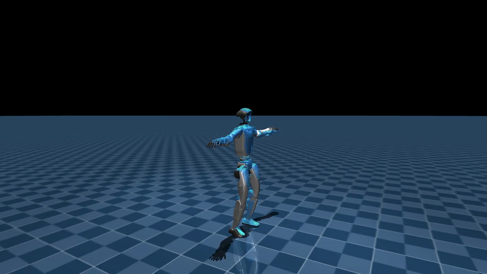
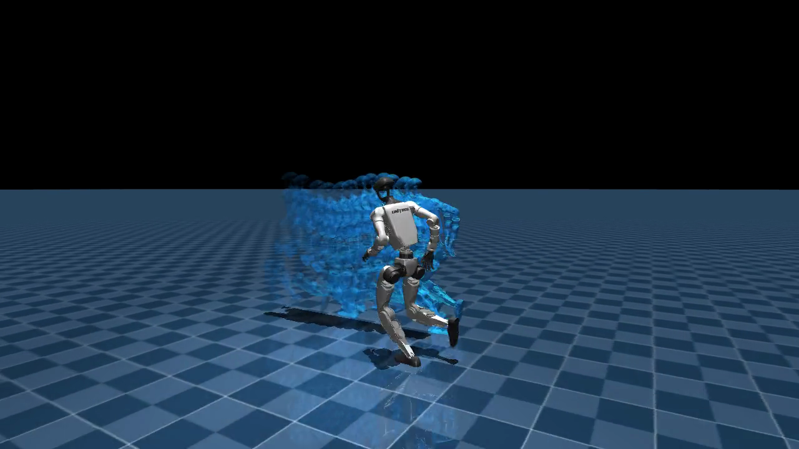

# SuperMimic 复现：单卡 4090 上的 Unitree G1 全身动作跟踪

复现 Liao et al., *SuperMimic: Scaling Humanoid Whole-Body Control with One Differentiable World Model*（CoRL 2026, [arXiv:2610.28480](https://arxiv.org/abs/2610.28480)）。方法用一个可微世界模型替代仿真器内的策略梯度：世界模型拟合 MuJoCo Warp 的转移，策略在想象轨迹上做短视野 BPTT。

本仓库记录在单张 RTX 4090（24 GB）上复现该流程的代码、数据与评测结果。基础实现来自 [CuboiLeo/SuperMimic-Reproduced](https://github.com/CuboiLeo/SuperMimic-Reproduced)（论文口径实现），本仓库补充训练环境适配、离线渲染管线、世界模型推理与可视化工具。

## 结果

训练数据为 LAFAN1 的 40 条动作（2.45 小时），最终检查点为 44,000 次迭代。

| 指标 | 数值 |
| --- | --- |
| 训练时长 | 4.3 小时（RTX 4090，2.0 it/s） |
| 训练回报 | 0.752 |
| 世界模型 1 步误差 | 0.0088 |
| 世界模型 8 步开环误差 | 0.0096（论文 0.007–0.011） |
| 固定 4 条动作的 benchmark | 0.886（步加权 0.894） |
| 全部 40 条动作评测 | 平均归一化回报 0.882，最高 0.969 |



*蓝色半透明为参考动作，实心机器人为策略。44,000 次迭代检查点。*

## 方法要点

- **世界模型**：71 维状态（根位姿、29 关节位置与速度、根线速度、根角速度），MLP(2048, 2048, 2048) 预测速度增量并显式积分；以回合级 sim context（摩擦、编码器偏置、质心偏移）为条件。
- **策略**：10 帧观测历史（930 维）+ 未来 10 帧参考目标（680 维，锚点观测另加 9 维），编码器-解码器结构。
- **训练**：每次策略更新在 32 步想象轨迹上做 BPTT，critic 提供轨迹末端自举；世界模型每轮用 8 步自回归窗口拟合。
- **评测**：每条动作从首帧确定性播放，归一化回报为逐步奖励和除以 0.1×步数，1.0 表示完美跟踪。

## 复现步骤

环境为单卡 24 GB，Python 3.12，torch 2.14，MuJoCo 3.16，MuJoCo Warp 3.16。

```bash
# 1. 基础实现
git clone https://github.com/CuboiLeo/SuperMimic-Reproduced.git
cd SuperMimic-Reproduced

# 2. 环境（AutoDL 镜像，自动检测驱动并选择 CUDA 版本）
bash setup_autodl.sh

# 3. 数据：LAFAN1 的 40 条 G1 重定向动作，转换为 50 Hz npz
bash download_lafan1.sh

# 4. 训练
env -u PYTHONPATH uv run sm-train --run-name lafan1_anchor \
  --data.npz-dir data/npz/lafan1 \
  --env.num-envs 2048 --policy-trainer.batch-size 2048 \
  --env.anchor-obs --schedule.max-hours 4.5

# 5. 评测
env -u PYTHONPATH uv run python scripts/eval_benchmark.py \
  --ckpt logs/lafan1_anchor/ckpt_latest.pt --npz-dir data/npz/lafan1
```

`--env.anchor-obs` 在目标中加入锚点相对位姿。LAFAN1 的动作长度在 100–270 秒之间，纯本体观测的策略缺少全局位姿反馈，整段播放会出现漂移；加入该观测后整段评测可达 0.88 以上。论文原始观测口径只影响长片段，对 BONES-SEED 这类 5 秒左右的短片段影响较小。

## 可视化

MuJoCo 渲染需要可用的 EGL/DRM。部分云容器未映射 `/dev/dri` 与 `/dev/nvidia-caps`，无法创建离屏上下文，因此本仓库把"仿真"与"渲染"拆开：

1. `scripts/dump_rollouts.py` 在 GPU 上回放策略，导出每帧 qpos/qvel 与逐条评测；
2. `scripts/render_rollouts_mac.py` 在任意有 OpenGL 的机器上（含 macOS）按导出的状态渲染视频，场景与相机参数对齐原渲染器（棋盘地面、方向光、跟踪相机、fovy 55）；
3. `scripts/render_wm_trail_mac.py` 渲染"仿真 + 世界模型预测拖影"的对比视频。



*灰白实体为 MuJoCo 仿真，蓝色拖影为世界模型从同一状态自回归想象的未来轨迹（间隔 0.05 秒）。*

世界模型推理同样可以离线运行：`scripts/wm_rollout_cpu.py` 仅依赖 torch 与 MuJoCo，在 CPU 上完成 500 步想象（约 2 秒），500 步内平均关节误差 0.062 rad、根部漂移 0.11 m。

## 数据与权重

- 最终检查点（44,000 次迭代，206 MB）发布在 Release 附件中。
- 40 条动作的演示视频与交互页面：<https://brianwang2007.com/posts/supermimic-repro/>
- 逐条评测与训练曲线见 [`results/`](results/) 目录。

## 仓库结构

```
scripts/          训练环境、数据转换、回放导出、离线渲染、世界模型推理
results/          训练曲线、逐检查点评测、逐动作评测、TensorBoard 标量导出
assets/           示意图
docs/             AutoDL 环境配置记录
```

## 训练记录

| 迭代 | 训练回报 | 世界模型 8 步误差 | 4 动作 benchmark |
| --- | --- | --- | --- |
| 4,000 | 0.45 | — | 0.449 |
| 8,000 | 0.59 | 0.06 | 0.590 |
| 12,000 | 0.65 | 0.04 | 0.650 |
| 16,000 | 0.71 | 0.03 | 0.712 |
| 20,000 | 0.80 | 0.02 | 0.803 |
| 24,000 | 0.77 | 0.02 | 0.769 |
| 28,000 | 0.81 | 0.02 | 0.815 |
| 32,000 | 0.84 | 0.02 | 0.844 |
| 36,000 | 0.86 | 0.02 | 0.864 |
| 40,000 | 0.87 | 0.02 | 0.867 |
| 44,000 | 0.88 | 0.02 | 0.886 |

24,000 次迭代附近的回落对应策略从"保持存活"向"跟随参考"过渡的阶段，训练日志中可见存活率与回报的反向变化。

## 引用

```bibtex
@inproceedings{liao2026supermimic,
  title     = {{SuperMimic}: Scaling Humanoid Whole-Body Control with One Differentiable World Model},
  author    = {Liao, Qiayuan and Shao, Yiyang and Long, Junfeng and Zakka, Kevin and Horowitz, Roberto and Abbeel, Pieter and Sreenath, Koushil},
  booktitle = {Conference on Robot Learning (CoRL)},
  year      = {2026}
}
```

数据为 [LAFAN1](https://github.com/ubisoft/ubisoft-laforge-animation-dataset) 的 G1 重定向版本（[lvhaidong/LAFAN1_Retargeting_Dataset](https://huggingface.co/datasets/lvhaidong/LAFAN1_Retargeting_Dataset)）。基础实现版权归 CuboiLeo/SuperMimic-Reproduced 作者所有，遵循 MIT 许可。
